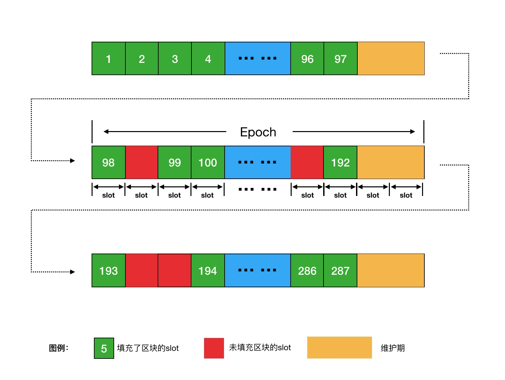
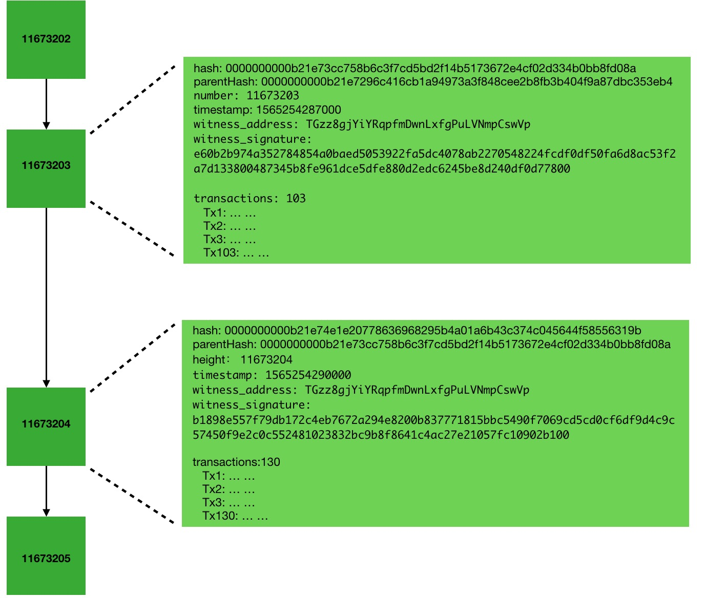
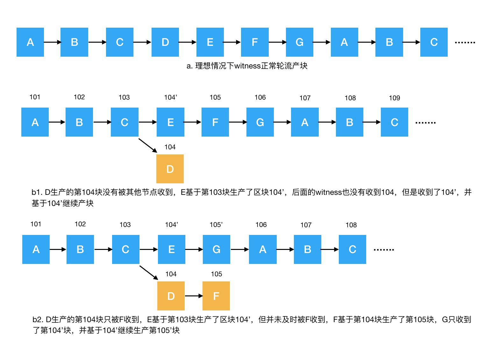
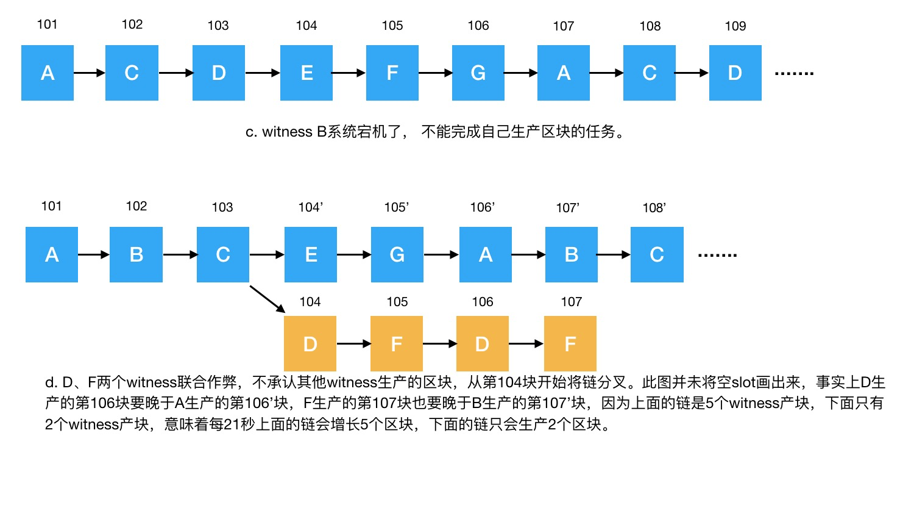

# TRON DPoS 共识机制

## 概述

区块链作为一种分布式账本系统，可以由分布在不同地区的众多独立节点共同维护，它们各自保存账本副本，并通过网络同步数据。要将新的交易数据写入这个共享账本，节点需要按照共识规则验证交易，并就接受哪些区块达成一致。在部分参与者可能发生故障或实施恶意行为的分布式环境中实现这一目标，是一个复杂的系统工程。

**共识机制**定义了达成这种一致所需遵循的规则。不同共识机制对参与方式和达成一致的要求各不相同。

目前主流的共识机制包括工作量证明（PoW）、权益证明（PoS）和委托权益证明（DPoS）。每种机制在不同的区块链系统中都有其独特的具体实现。本文将重点介绍 **TRON 网络** 所采用的 DPoS 共识机制，并详细阐述其核心组件和运作原理。

### DPoS 共识机制

DPoS 共识机制在区块链系统中的核心作用是选举出**超级代表（Super Representative，简称 SR）**，即网络的指定区块生产者（或出块节点/Block Producer）。这些 SR 负责验证交易数据并将其记录到账本中，随后将包含新账目的区块广播至全网，并获得其他节点的认可。

在 DPoS 共识中，系统会根据节点获得的选票数量来选定一部分节点作为区块生产者。整个选举流程具体如下：

1. 初始准备: 当区块链系统启动时，会发行一定数量的 **token**（例如 TRON 的 TRX）。
2. 成为候选人: 节点可以消耗一部分 token 来申请成为区块生产者候选人。
3. 社区投票: 网络中任何持有 token 的节点都可以为这些候选人投票。
4. 计票选举: 每经过一个预设的时间周期（例如 `t`），系统会统计所有候选人的得票数量，得票数排名前 `N` 的节点将成为下一个时间周期内的区块生产者。
5. 周期轮换: 时间周期结束后，系统会重新统计并选出新的区块生产者，如此循环往复。

下面将结合 TRON 网络中的具体实现进行详细说明。

## 核心概念定义

| 概念 | 定义 |
| -------- | -------- |
| TRON     | TRON 区块链网络。本文不区分 TRON、TRON 区块链、TRON 区块链系统等概念。|
|TRX| 由 TRON 区块链系统发行并在系统中流通的权益 token，代号为 **TRX**。|
|超级代表 (SR)|TRON 网络中获得区块生产资格的节点。TRON 设定区块生产者的数量为 **27 个**。下文不区分区块生产者、记账人、Witness、SuperNode、SR 等概念。|
|超级代表候选人（Super Representative Candidate）| TRON 网络中具备成为区块生产者资格的节点。|
|超级代表合伙人（Super Representative Partner / SRP）| 得票数排名第 **28** 至 **127** 名的超级代表候选人被称为**超级代表合伙人**。他们不参与区块生产或交易打包，但可以获得投票奖励。投票给超级代表合伙人的选民可以分享扣除该合伙人佣金后剩余的奖励。|
|生产区块 / 记账|指验证交易并将交易记录为账目的过程。由于 TRON 中的账目由区块承载，因此记账过程也被称为**生产区块**，SR 也被称为**区块生产者（Block Producer）**。下文不区分生产区块和记账。 |
|出块顺序（记账顺序）| 27 个区块生产者按照得票数量从高到低进行排序，以此确定其生产区块的顺序。当两个 SR 的得票数相同时，使用其地址作为决胜依据，以产生确定的顺序。|
|槽位（Slot）|在 TRON 网络中，每 **3 秒钟**被计为一个槽位。正常情况下，每个生产区块的 SR 都会在对应的槽位时间内完成出块。因此，TRON 的平均出块间隔约为 3 秒。如果因故 SR 未能产块，则对应的槽位会空置，下一个 SR 会在接下来的槽位内生产区块。在维护期，产块会跳过 2 个槽位。|
|出块轮（Epoch）| 一个出块轮是相邻两次预定维护时间之间的间隔，当前主网设为 **6 小时**。该间隔可以通过**链上提案**调整。|
|维护期|当节点处理首个时间戳达到或超过预定维护时间的区块时，会触发维护。维护时会统计选票、重新选出 27 个 SR，并更新其出块顺序。在触发维护的区块之后，产块会**跳过 2 个槽位**（**6 秒钟**）。在当前主网维护间隔为 6 小时且正常出块的情况下，每天会进行 **4 次维护**。|

## 超级代表的产块流程

TRON 区块链系统中的 SR 持续执行以下流程：

1. **收集交易：** SR 收集区块链网络中新产生的交易。
2. **验证交易：** 对这些交易的合法性进行验证。
3. **打包区块：** 将验证通过的交易打包在一个**区块**中，作为新的一页账记录到账本上。
4. **广播区块：** 将新生成的区块在整个区块链网络中进行广播。
5. **其他节点验证：** 其他节点接收到新区块后，也会验证其中交易数据的合法性，并将其添加到自己的账本中。

SR 持续重复此过程，确保 TRON 系统中所有新的交易数据都被及时记录到账本中。

## 超级代表的选举机制

### 选票

在为 SR 投票之前，账户需要获得**投票权**，即 **TRON Power (TP)**。投票权通过**质押 TRX** 获得。除了获取带宽或能量，质押 TRX 还会同时为用户带来投票权。每质押 **1 TRX**，用户将获得 **1 TP**。

解除通过 **Stake 1.0** 质押的 TRX，会清空该账户已有的全部投票。

在 **Stake 2.0** 下，解除 TRX 质押会减少账户的 TP。如果剩余 TP 足以覆盖账户的总投票数，已有投票保持不变；否则，会以剩余 TP 为基数，按该账户原先分配给各候选人的票数比例重新计算各候选人的票数，并分别向下取整。因此，保留的总票数可能少于剩余 TP。

选票统计以及超级代表和超级代表合伙人的更新在每个维护期进行，当前主网每 **6 小时**安排一次维护。如果在选票统计前，一个账户进行了多次投票，TRON 网络只会记录该账户的**最新一次投票**，之前的投票将被覆盖。

### 投票过程

在 TRON 中，对候选人的投票被定义为一种特殊类型的**交易**。节点可以通过生成一笔投票交易来为候选人投票。

### 统计选票

每个**维护期**内，系统会统计一次所有候选人的得票数，并将获得票数最多的 **27 个**候选人选定为下一个出块周期的 SR。

## 产块机制

在一个**出块轮**中，27 个 SR 将按照**产块顺序**依次生产区块。每个 SR 只能在轮到自己产块时进行区块生产。

SR 将多笔验证合法的交易数据打包到每个区块中。同时，每个区块都会将上一个区块的 **哈希值**（`hash`）作为本区块的**父哈希值**（`parentHash`）填入。此外，SR 还会使用自己的私钥对本区块的数据进行签名，将**签名结果**（`witness_signature`）以及 SR 的地址、区块高度、区块生成时间等数据一并填入区块。

通过这种方式，每个区块都保存了上一个区块的哈希值，从而在逻辑上将区块相互关联起来，最终形成了区块链的链式结构。典型的区块链结构示意图如下：

理想情况下，采用 DPoS 共识的区块链系统记账过程应严格按照预先计算好的记账顺序，由超级代表轮流依序产块（如下图 a）。然而，实际的区块链网络是一个分布式、不可信的复杂系统，可能出现以下情况：

1. **网络延迟：** 由于网络链路环境不佳，超级代表生产的区块可能无法在有效时间内被其他超级代表收到（如下图 b1、b2）。
2. **节点故障：** 某些超级代表可能无法始终正常运行（如下图 c）。
3. **恶意行为：** 少数超级代表可能恶意生产分叉区块，试图分裂主链（如下图 d）。

区块链系统安全的首要保证是账本的安全：账本既不能被恶意写入不合法数据，账本在各个节点上保存的副本也应该保持一致。从 DPoS 共识的角度来看，记账过程由超级代表完成。在 TRON 的区块固化确认中，每个活跃超级代表的确认权重相同，因此，TRON 的安全性依赖于足够数量的活跃超级代表诚实可靠地遵守共识规则。

TRON 设定了**不可逆转区块**（或称**固化块**）机制，同时为了抵抗少数 SR 的恶意行为，TRON 采用基于**最长链原则**来确认主链。

### 固化块原则

新生产出的区块初始处于未确认状态。固化过程如下：

* 当至少 **70%** 的**当前活跃 SR** 在当前链上最近生产的区块高度大于或等于目标区块的高度时，目标区块就成为**不可逆区块**，通常称为**固化块**。在有 27 个活跃 SR 的情况下，需要 **19 个不同的 SR** 满足这一条件。区块固化后，其中的交易即被整个网络永久确认。
* SR 通过生产目标区块本身，或在其基础上生产后续区块，来表示对该区块的认可。只有当前活跃集合中的 SR 才计入确认门槛，因此维护时活跃集合的变化可能改变哪些生产者被计入。活跃集合发生变化时，已记录的固化高度不会降低。
* 当 27 个活跃 SR 的集合保持不变时，原区块生产者加上在目标区块基础上生产后续区块的**另外 18 个互不相同的 SR**，就足以使目标区块固化。同一 SR 重复出块不会增加不同 SR 的确认数。

图 d 展示了一个由固定的 **7 个 SR（A–G）** 组成的简化网络。在这个示例中，70% 的门槛需要 **5 个不同的 SR** 确认。超级代表 C 生产了第 103 块，超级代表 E 在第 103 块的基础上生产了第 104' 块，超级代表 G、A、B 分别在同一分支上生产了第 105'、106'、107' 块。这些都是第 103 块的后续区块，表示其生产者对 C 生产的第 103 块的认可。因此，当第 **107'** 块被生产出来时，第 **103 块就成为固化块**，因为它此时已经有了由 4 个不同 SR 生产的 4 个后续区块。加上原区块生产者 C，共有 **5 个不同的 SR 确认**。

### 最长链原则

当区块链发生分叉时，诚实的超级代表总是会选择在当前**最长**的分叉链上继续生产区块。仅仅收到另一条高度相同的分支，并不会触发链切换。

## 激励模型

为了保证 TRON 区块链系统安全高效地运行，TRON 设计了激励模型，以鼓励更多节点加入 TRON 网络，从而扩大网络规模。

下方所列的奖励数额为通过链上提案调整后的**当前主网值**，并非协议硬编码，未来仍可通过提案再次调整（详见[基于提案的参数调整](#proposal-based-parameter-adjustment)）。

* **区块生产奖励：** TRON 网络每成功生产一个区块，会向该区块的生产者（即对应的超级代表）奖励 **8 TRX**。该超级代表在根据其设定的佣金比例扣除佣金后，会将剩余部分根据投票者的投票权重分配给支持他们的选民。
* **投票奖励：** 随着每个区块的产生，TRON 网络还会向所有超级代表和超级代表合伙人额外奖励 **128 TRX**。这笔奖励将根据他们各自获得的投票比例进行分配。同样，超级代表和超级代表合伙人在根据其设定的佣金比例扣除佣金后，会将剩余的投票奖励根据选民的投票权重分发给对应的选民。

## 基于提案的参数调整

TRON 节点软件已支持的动态链参数可以通过**链上提案**调整。SR 通过对提案的投票来决定提案是否生效。

目前 TRON 的网络参数及其值，以及过往的提案记录，请参考 [TRONSCAN 委员会](https://tronscan.org/#/sr/committee) 页面。

## 参考文档

* [The Basics of TRON’s DPoS Consensus Algorithm](https://medium.com/tronnetwork/the-basics-of-trons-dpos-consensus-algorithm-db12c52f1e03)
